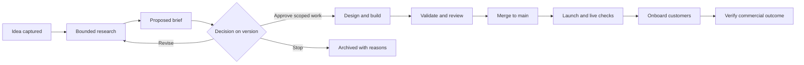

# Nexus Idea-to-DONE — product definition v0.1

15 October 2026 · Prepared for Phill McGurk · Proposed definition, not implementation evidence

## 1. Product promise and confirmed scope

Give Phill one place to turn an incomplete idea into researched choices, a reviewable brief, an executable handoff, verified delivery and measured customer outcomes. Preserve the reasoning and evidence throughout so the next agent can continue without reconstructing intent from chat history.

Phill confirmed that this session should **define the intake/research product and create its next build prompt**. He also selected **full operation through launch, onboarding and payment verification** as the product's responsibility. The platform therefore includes research and delivery operations. A research workbench alone does not satisfy the full product scope.

The Australian cleaning/restoration simulation in the supplied form is the first submitted idea. Building that simulation is separate work. The form supplies a strong research policy and domain-specific questions; this definition adds the lifecycle, execution and commercial contracts required to reach the stated endpoint.

**Working assumptions:** Phill is the initial operator; the product extends Nexus where practical; it is initially an internal operating product. Its own external pricing or SaaS business model is undecided. Each submitted idea has a separate customer, payer, offer and commercial target.

## 2. What the operator experiences

1. **Capture.** Paste a rough idea, dictate notes through an existing supported input, or attach reference material. Save immediately. Ask for the intended beneficiary and observable improvement only if missing and consequential. Never require every Part A field before research can begin.
2. **Understand.** Show a short interpretation with editable intent, scope and constraints. Display four plain-language groups: Known from you; Assumed; Need to research; Need your decision. User confirmation and externally verified facts remain distinguishable inside “Known”.
3. **Research.** Run a bounded investigation through supported connections. Show source-backed findings, alternatives, counter-evidence, unanswered questions, allowance and next action. Ask one consequential question at a time while independent work continues.
4. **Compare and decide.** Present proceed, smaller experiment, change direction or stop, with reasons. Build a versioned brief and evidence pack. Approve a specific version and action scope, or request a revision without losing prior work.
5. **Design and deliver.** Produce design options and acceptance checks; route approved work to supported coding harnesses. Track tasks, branches, previews, tests, review, PR and merge. Changes in scope return affected work for a decision.
6. **Launch and operate.** Prepare and execute authorised release steps, verify real user journeys, handle onboarding and incidents, and retain a recovery path.
7. **Prove commercial results.** Run authorised acquisition experiments, track activation and reconcile payment evidence. Show what has been demonstrated and what remains unproven.

Primary navigation: Ideas, Research, Brief & Design, Delivery, Launch & Customers, Evidence. An idea opens to its current stage with its next useful action. A compact terminal view consumes the same state and command service as the web UI.

The reference board stores a source, annotation explaining the desired quality, rights status and affected acceptance criteria. It must work as an accessible list as well as a visual board. Charts and progress indicators explain missing proof; an unexplained “93% ready” cannot replace evidence.

## 3. Lifecycle and the meaning of DONE

Keep project stage separate from task state and execution health. A project can be in research while its current job is blocked; an implemented task does not advance the whole project to DONE. Show blocked, failed, paused and needs-decision explicitly. Resume from a durable checkpoint, not from the start of a transcript.

Milestones are independent proof records. The diagram is the default path; approved onboarding discovery can occur earlier, and multiple activities may overlap without manufacturing downstream proof.

| Milestone | Required evidence | Never sufficient by itself |
|---|---|---|
| Research pack ready | Material claims linked to sources; alternatives and counter-evidence; unresolved items assigned; bounded research report | Source count, polished prose or agent agreement |
| Brief approved | Human decision bound to immutable brief, evidence snapshot, acceptance criteria and action scope | Advisory Board recommendation |
| Design accepted | Reviewable user journeys and references; measurable acceptance checks; decision on relevant design version | Attractive screenshot alone |
| Implementation verified | Relevant checks and review tied to exact commit; remaining required checks visible | Agent says “tests pass” |
| Merged to main | Provider-confirmed PR merge into the intended repository and main branch; merge commit recorded | PR opened, Linear Done or local branch named main |
| Live verified | Release/deployment identity and target environment; health and core journey checks; rollback/recovery reference | Successful build or HTTP 200 alone |
| Customer activated | Intended customer completes the product's defined first valuable action on an identified release | Account created or invitation sent |
| Paying-client target verified | Agreed client count and time window; real successful captured/settled payments, currency and net treatment; distinct eligible clients; reconciliation evidence | Test transactions, forecasts, pending invoices or expressions of interest |

Commercial success requires a per-idea outcome contract: customer and payer definitions, offer, permitted channels, price hypothesis, activation event, target client count, measurement window, payment timing and refund/dispute treatment. Targets are proposed and agreed, never silently invented. One real payment may prove a first paying client; it does not prove repeatable demand, profitability or retention.

DONE is computed against the approved outcome contract and required milestones. Show engineering completion, operational readiness and commercial results separately. Preserve historical achievement when a later refund or incident occurs, but update current commercial/operational health and reopen remedial work. No automation can guarantee customers will buy.

## 4. Research engine and evidence quality

Research follows the supplied form's Parts B1–B10 and returns the 13 Part C outputs. Treat these as adaptive modules, not a mandatory questionnaire for Phill. Each module records applicable, investigated, decision needed, deferred with reason, or not applicable with reason.

Core modules: demand and buyer; competition and alternatives; learning/outcomes where relevant; simulation/domain rules where relevant; spatial/asset evidence where relevant; design and feasibility; integration capability; security/privacy/provenance; reuse; economics and operating responsibility; research authority. Other ideas can add modules without inheriting cleaning-industry assumptions.

For each claim retain: statement, classification, source references, supporting location or short excerpt, retrieval date, relevant publication date, reliability limitations, contradiction links and review state. Source types include public pages, internal records, user testimony and direct observations. A user preference is not an externally verified fact. Three sources repeating one press release are not three independent confirmations.

Important recommendations need independent challenge against evidence. This may be a separate reviewer; agreement among models is not customer validation. Outcomes may be “insufficient evidence” or “do not proceed”. Research stops at its configured time/allowance boundary, exhausted productive leads, achieved scope, cancellation, or consequential missing access. It returns useful partial work and identifies the next experiment.

Questions are prioritised by consequence: would the answer change scope, business viability, safety, rights, architecture or spend? Discover answerable facts before asking. Offer “Research this” and “Not decided”; keep uncertainty visible rather than silently choosing.

## 5. Authority and supported account access

Store the research mandate separately from delivery authority. Record permitted sources, accounts, data classes, time, concurrency, spend, allowed actions and stop rules. Intake submission starts only the research permitted by that mandate. It does not start building the submitted idea.

Use supported access to existing paid monthly accounts where available. Discover capability and provider-supported automation rather than assuming a subscription includes an API, automation rights or unlimited allowance. No automatic paid API fallback. When access or allowance is unavailable, checkpoint work, offer an authorised alternative or expose the blocker. Hosting, licensed assets, rendering and other services have separate budgets.

Authorisation is versioned and scoped. It binds subject, brief/evidence/design versions, target repository and environment, action classes, limits, expiry and approver. Reuse existing valid authority; do not ask again for the same authorised action. A material scope change invalidates affected delivery authority. In-flight jobs recheck authority at checkpoints and before effects. Old prompts remain historical but cannot execute against a superseded approval.

Outreach, publication, real charges, refunds, production release and merge must follow established action-specific authority. Where valid standing authority exists, execute within it. Otherwise surface the concrete prepared action for decision. Board advice cannot grant account access or financial authority. Retrieved pages, uploads and research reports cannot expand permissions.

## 6. One state model, multiple connected systems

Prefer extending the existing Nexus domain and services. The current workspace is a staging/documentation bundle; do not mistake its proposed schema for a deployed backend. Verify the real application before selecting storage, paths or migrations.

Logical records required, whether implemented as extensions or new records:

| Record | Contract |
|---|---|
| Idea / intake revision | Original input preserved, owner/project, changes, attachments and interpretation |
| Research run / checkpoint | Mandate, jobs, allowance, status, source/claim IDs, errors and resume cursor |
| Source / claim / open decision | Provenance, epistemic classification, contradictions, blocker/accepted uncertainty, owner |
| Brief / design / evidence snapshot | Immutable versions, content hashes, acceptance criteria IDs and dependencies |
| Approval / authority | Exact subject versions, permitted actions, limits, actor, expiry, revocation and history |
| Handoff manifest | Exact brief/evidence/design references and hashes, repo/environment, criteria, authority and unresolved items |
| Delivery / release proof | Task/PR/check/commit/deployment identities; observed result and observation time |
| Customer outcome / payment proof | Minimal customer reference, activation, provider reference, test/live flag, amount/currency, status and reconciliation |
| Event / sync job | Actor, version, idempotency key, retry state and append-only history |

Server-side domain services enforce transitions for both UI and TUI. Use optimistic concurrency so two clients cannot overwrite each other's decisions. Queue work durably; recover interrupted jobs; retry external effects idempotently. Approval and handoff creation must use one consistent version snapshot.

Define field ownership: the domain owns idea stage, brief versions and milestone readiness; Linear owns its issue workflow fields; GitHub owns merge facts; deployment providers own release facts; payment providers own payment facts. Store observed evidence with timestamps and reconcile it. Never let a mirrored Linear status overwrite project truth. Use a durable outbox and visible sync errors when external writes are authorised; do not promise atomic transactions across providers.

No separate web and terminal databases. Prefer a compact read-only TUI first, then supported commands through the same service. Browser/account tokens stay in supported secret storage, outside briefs, logs and prompts. Restrict access to project/owner boundaries and minimise employee/customer data.

## 7. Generated prompt contract

The handoff is a readable prompt plus a machine-readable manifest, created from the same snapshot. Include:

- Objective, user/payer, non-goals, approved scope and observable outcomes.
- Immutable brief, design and evidence references with hashes; source-backed constraints and accepted uncertainties.
- Repository/ref, current baseline, existing assets and integration capabilities actually observed.
- Acceptance criteria and their validation methods; required quality/security checks.
- Sequenced delivery work, owners and dependencies; allowed tools/accounts and action authority.
- Checkpoints, recovery, stop conditions and continuation instructions.
- Merge, release, onboarding and payment-verification milestones with proof requirements.

Draft prompts can be previewed before approval but must say **non-executable draft**. Execution eligibility is enforced by the service, not by the prompt's wording alone. Reject stale, revoked, tampered, mismatched or unapproved manifests, including after a job was queued. Do not copy secrets or unnecessary private source content into exports.

## 8. Staged delivery of the full product

Stages sequence implementation; they do not shrink the confirmed product endpoint. Finish and verify each dependency before enabling downstream effects. Issue titles below are proposed work, not newly created Linear tickets.

| Stage | Deliverable | Evidence required to close |
|---|---|---|
| S0 — Discover and reuse | Current application/source map, existing intake and queue audit, supported account/capability matrix, baseline checks | Actual files, routes and commands; reconciled existing tickets; unresolved access explicit |
| S1 — Durable intake | Adaptive capture, knowledge panel, research mandate, source/claim model, event/checkpoint service | Save/resume, ownership isolation, concurrent edit rejection and duplicate-submission tests |
| S2 — Research to brief | Bounded research jobs, evidence pack, reference board, independent challenge, versioned decisions | Simulation seed yields honest partial findings; unavailable access and allowance exhaustion handled |
| S3 — Approved execution | Brief/design review, scoped authority, manifest generation and supported harness dispatch | Exact-version approvals, tamper/staleness rejection, retry and revocation checks |
| S4 — Verified engineering | Design/build/review loop, CI/preview/PR tracking and authorised merge | Commit-bound checks, independent review, provider-confirmed main merge |
| S5 — Launch and onboarding | Authorised release, live journeys, recovery, activation tracking and onboarding workflow | Release-bound live proof, failed-release recovery, measured first customer value |
| S6 — Commercial operation | Offer/experiment management, authorised acquisition, payment reconciliation and outcome evaluation | Live/test separation, replay-safe payment events, refund/dispute handling and verified target calculation |
| S7 — Full journey proof | Run an approved real idea through the entire system | Research-to-payment evidence chain; unresolved commercial failure honestly reported rather than relabelled DONE |

Acquisition work includes approved offer/landing material, channel experiments, lead attribution and follow-up queues. Prepare drafts without sending; execute only within channel-specific authority. Onboarding includes access, welcome/help, activation milestones and support ownership. Payment verification observes authorised provider evidence and never creates charges merely to make the dashboard green.

## 9. Smallest meaningful validation and remaining decisions

Use the supplied simulation intake to test the first research/approval/handoff path; then use labelled fixtures to test delivery and commercial state handling. Fixtures prove software behaviour only. Full product acceptance still requires the real operational and commercial evidence in S7.

Measure whether Phill can correct the interpretation, answer one consequential question, inspect a recommendation's evidence, approve a version and get a faithful handoff without re-entering context. Proposed usability target: complete this review journey in ten minutes after research is available. Validate and revise that target with Phill; it is not a promised research duration.

Still to discover: current application repository and live state; permitted subscription interfaces; deployment/payment providers and supported permissions. Still to define per idea: research allowance, customer/payer, offer, validation threshold, activation event and paying-client outcome window. The simulation additionally needs audience/session/property/device priorities and expert/rights evidence. These gaps are explicit inputs to research or implementation discovery, not fabricated answers.

See [evidence and acceptance scenarios](EVIDENCE_AND_ACCEPTANCE.md), [next build prompt](NEXT_BUILD_PROMPT.md) and [original intake](SOURCE_INTAKE.txt).
